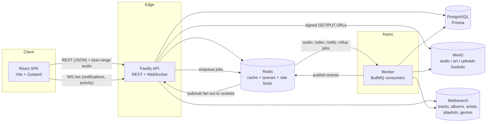
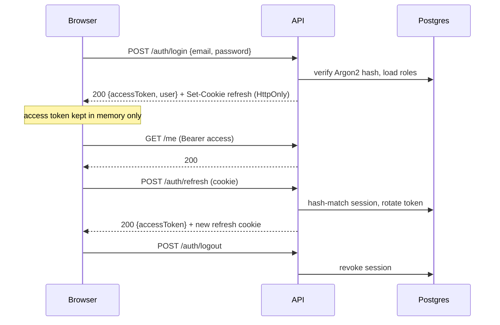
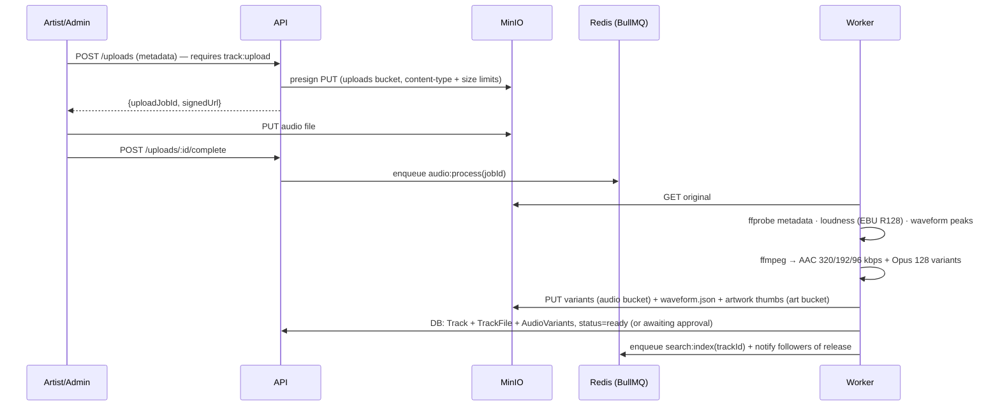

# air — Architecture

## 1. System overview

air is a containerized set of services. The SPA talks to a single Fastify API; heavy work
(audio transcoding, waveforms, search indexing, analytics rollups) happens asynchronously
in a worker that shares the API codebase and consumes BullMQ queues on Redis.



**Why one codebase for API + worker?** They share Prisma models, config, queue
definitions, and domain services. They are deployed as separate containers (different
commands on the same image), so they still scale independently.

## 2. Backend module map

`apps/api/src/modules/` — one folder per bounded context, each exposing a Fastify plugin
(`routes.ts`) and pure service functions:

```
auth/           login, register, refresh rotation, logout, sessions
users/          profiles, follows, settings, API keys
artists/        artist pages, follow, monthly listeners, related artists
albums/         album pages, credits, popularity
tracks/         track catalog, credits, waveforms
genres/         (inside tracks/) genre browse
playlists/      CRUD, collaborative editing, sharing, pinning, folders
favorites/      like tracks / albums / artists / playlists
history/        plays, recently played, listening sessions, resume state
search/         Meilisearch proxy, autocomplete, recent + trending searches
uploads/        signed upload URLs, upload jobs, moderation queue
streaming/      byte-range streaming, variant selection, signed segment auth
analytics/      event ingestion + dashboard aggregates
recommendations/ modular scorers (collaborative, genre, popularity, recency)
notifications/  in-app + realtime notifications
admin/          user/artist management, approvals, system health, audit log
shared/         prisma, redis, s3, meili, errors, pagination, rbac, audit, ws hub
```

Cross-cutting concerns are Fastify plugins: `auth` (JWT verify + RBAC decorators),
`security` (CORS, helmet/CSP, cookies, rate limiting), `websocket` (socket hub bridged to
Redis pub/sub so any API instance can push to any client).

## 3. Authentication flow

- **Access token:** short-lived JWT (15 min), sent as `Authorization: Bearer`. Carries
  `sub`, `roles`, `perms` snapshot.
- **Refresh token:** opaque 256-bit random value, stored **hashed** (SHA-256) in
  `AuthSession`, delivered as an `HttpOnly; SameSite=Lax; Secure` cookie scoped to
  `/auth`. Rotated on every refresh; reuse of a rotated token revokes the whole session
  family (theft detection).
- **Passwords:** Argon2id, per-hash salt, tuned memory cost.
- **API keys:** for server-to-server ingestion; hashed at rest, scoped permissions.



CSRF: the API is a pure JSON API behind CORS with credentialed requests limited to the
configured `WEB_ORIGIN`; the refresh cookie is `SameSite=Lax` and `POST /auth/refresh`
additionally requires the custom `x-air-client` header (not settable cross-site by simple
requests). State-changing routes require the Bearer token, which is never in a cookie.

## 4. Upload pipeline



`UploadJob.status`: `pending → uploaded → processing → ready | failed | rejected`.
Non-admin artist uploads land in `awaiting_approval` and are published from the admin
dashboard. Every transition is audit-logged.

## 5. Streaming service

- `GET /stream/:trackId?quality=high|med|low|auto` — validates a **signed, short-lived
  stream token** (issued per track by `POST /tracks/:id/stream-token` from an authorized
  session), picks the best `AudioVariant` for the requested quality, and proxies the
  object from MinIO honoring **`Range` byte-range requests** (`206 Partial Content`,
  `Accept-Ranges`, correct `Content-Range`), which gives seeking + progressive playback
  in the browser `<audio>` element.
- **Adaptive selection:** the client measures throughput and re-requests with a different
  `quality`; the server also caps quality by role/plan.
- **Resume:** the client posts progress heartbeats (`POST /history/progress`); on
  reconnect `GET /history/resume` returns the last track + position, and playback resumes.
- **Accounting:** bytes served and ms played feed `ListeningSession` and daily analytics
  rollups (bandwidth, listeners, retention).

## 6. Search

Meilisearch holds five indexes (`tracks`, `albums`, `artists`, `playlists`, `genres`)
with typo tolerance and per-index ranking (popularity boosts). The worker keeps indexes
in sync on entity writes. The API adds: recent searches (per-user, Redis LRU list) and
trending searches (Redis sorted set with daily decay).

## 7. Recommendations

A modular scoring pipeline in `recommendations/` — each scorer is a pure function
`(userSignals, candidates) → scored[]`, combined by weighted sum, all offline-friendly and
DB/Redis-only (no external AI services):

1. **Collaborative filtering** — item-to-item co-occurrence of tracks across user
   histories (users who played X also played Y).
2. **Genre similarity** — Jaccard overlap between a user's top genres and candidates.
3. **Listening history recency** — boost artists/albums heard recently but not repeated.
4. **Popularity prior** — global play-count prior, damped so it never dominates.

Results power Home ("Made for you", "Because you listened to…"), artist "related
artists", and radio-style queue autofill.

## 8. Frontend component hierarchy

```
App
├─ Providers (theme, auth bootstrap, WS)
├─ AppLayout
│  ├─ Sidebar (nav, library, pinned playlists, folders)
│  ├─ Topbar (search box w/ autocomplete, profile menu)
│  ├─ <Outlet/> pages:
│  │   Home · Search · Library · Album · Artist · Playlist · Queue
│  │   Profile · Settings · Upload · Dashboard(admin) · 404
│  └─ PlayerBar (transport, seek, volume, speed, sleep timer, mini/full toggle)
│     └─ FullscreenPlayer (artwork, waveform, queue peek)
└─ Auth pages (Login, Register) outside AppLayout
```

State (Zustand stores): `auth` (user, access token in memory), `player` (queue, shuffle,
repeat, progress — a headless engine around one `<audio>` element), `library` (likes,
pins, folders), `ui` (theme, panels). Server data is fetched through a typed API client
with automatic 401→refresh→retry. Long lists (tracks, search results) render through a
lightweight windowing component; routes and heavy pages are lazy-loaded.

## 9. Security posture

RBAC (roles→permissions, checked per route) · Redis-backed rate limiting · zod validation
on every input · Prisma (parameterized queries only) · CSP + security headers · HttpOnly
Secure cookies · audit log on privileged mutations · signed upload + stream URLs ·
secrets only via environment.

## 10. Scalability notes

Stateless API (JWT + Redis pub/sub for sockets) → horizontal scaling behind any load
balancer. Worker concurrency per queue. Postgres read-mostly catalog is cache-friendly
(Redis, `Cache-Control` on public catalog GETs). Object storage does the heavy byte
serving; the stream proxy can be swapped for CDN-signed direct URLs without client
changes (the endpoint already issues redirect-style variant URLs internally).
