# air — Database ERD

Source of truth: [`apps/api/prisma/schema.prisma`](../apps/api/prisma/schema.prisma).
Regenerate SQL with `npx prisma migrate diff --from-empty --to-schema-datamodel prisma/schema.prisma --script`.

```mermaid
erDiagram
    User ||--o{ UserRole : has
    Role ||--o{ UserRole : grants
    Role ||--o{ RolePermission : maps
    Permission ||--o{ RolePermission : "granted via"
    User ||--o{ AuthSession : "refresh sessions"
    User ||--o{ ApiKey : owns
    User ||--o{ AuditLog : "acts in"

    User |o--o| Artist : "owns profile"
    Artist ||--o{ Album : releases
    Album ||--o{ Track : contains
    Artist ||--o{ Track : performs
    Album ||--o{ AlbumArt : "art sizes"
    Track ||--o{ TrackFile : "original masters"
    Track ||--o{ AudioVariant : "streaming encodes"
    Genre ||--o{ TrackGenre : tags
    Track ||--o{ TrackGenre : tagged
    Genre ||--o{ AlbumGenre : tags
    Album ||--o{ AlbumGenre : tagged
    Genre ||--o{ ArtistGenre : tags
    Artist ||--o{ ArtistGenre : tagged

    User ||--o{ Playlist : owns
    Playlist ||--o{ PlaylistTrack : orders
    Track ||--o{ PlaylistTrack : "appears in"
    Playlist ||--o{ PlaylistCollaborator : "shared with"
    User ||--o{ PlaylistCollaborator : collaborates
    User ||--o{ PlaylistPin : pins
    Playlist ||--o{ PlaylistPin : "pinned as"
    User ||--o{ LibraryFolder : organizes
    LibraryFolder ||--o{ LibraryFolderItem : holds
    Playlist ||--o{ LibraryFolderItem : "filed in"

    User ||--o{ Favorite : likes
    Track |o--o{ Favorite : "liked track"
    Album |o--o{ Favorite : "liked album"
    Artist |o--o{ Favorite : "liked artist"
    Playlist |o--o{ Favorite : "liked playlist"
    User ||--o{ Follow : follows
    Artist |o--o{ Follow : "followed artist"
    User |o--o{ Follow : "followed user"

    User ||--o{ History : plays
    Track ||--o{ History : "played as"
    User ||--o{ ListeningSession : "listens in"
    User |o--o| PlaybackState : "resumes from"

    User ||--o{ UploadJob : uploads
    Artist ||--o{ UploadJob : "uploaded for"
    UploadJob |o--o| Track : produces
    User ||--o{ Notification : receives
    User |o--o{ SearchQuery : searches
    Track |o--o{ DailyStat : "daily stats"
    Artist |o--o{ DailyStat : "daily stats"
```

## Table notes

| Table | Purpose / notable constraints |
| --- | --- |
| `User` / `Role` / `Permission` (+ join tables) | RBAC. Roles: `listener`, `artist`, `moderator`, `admin`; permissions are string keys like `track:upload`. |
| `AuthSession` | Rotating refresh tokens, stored as SHA-256 hashes. `family` links rotations so reuse revokes the chain. |
| `ApiKey` | Hashed server-to-server keys with scoped permissions and expiry. |
| `AuditLog` | Actor, action, target, metadata, IP — written on every privileged mutation. |
| `Artist` | `monthlyListeners` is a worker-maintained rollup; `ownerUserId` links a user account. |
| `Album` / `AlbumArt` | Art stored per rendered size (`0` = original). `popularity` 0–100 recomputed nightly. |
| `Track` | Slugged, with credits JSON, lyrics, EBU R128 loudness, waveform object key, `playCount`, `popularity`, `publishedAt` (null = unreleased/awaiting approval). |
| `TrackFile` / `AudioVariant` | Original master vs. streamable encodes (format + bitrate unique per track). `WAV` variant type supports the pure-Node seed audio. |
| `Playlist` (+ `PlaylistTrack`, `PlaylistCollaborator`, `PlaylistPin`) | Ordered, collaborative, shareable via `shareId`. Position is a dense integer maintained on reorder. |
| `Favorite` | One row per like; **partial unique indexes** per (user, target) and a CHECK that exactly one target FK is set. |
| `Follow` | User→user or user→artist; CHECKs forbid self-follows and dual targets. |
| `History` | One row per play with `msPlayed`, `completed`, `source` context. Drives recommendations, charts, and rollups. |
| `ListeningSession` | Device/IP session with `msListened` and `bytesServed` for duration & bandwidth analytics. |
| `PlaybackState` | One row per user: current track, position, serialized queue — resume-after-reconnect. |
| `UploadJob` | Pipeline state machine: `PENDING → UPLOADED → PROCESSING → AWAITING_APPROVAL | READY | FAILED | REJECTED`, with reviewer + error. |
| `Notification` | Typed in-app notifications; realtime copies go over WebSocket. |
| `SearchQuery` | Raw search log → trending & "most searched" analytics. |
| `DailyStat` | Nightly rollups: global row (null FKs) plus per-track and per-artist rows. |
